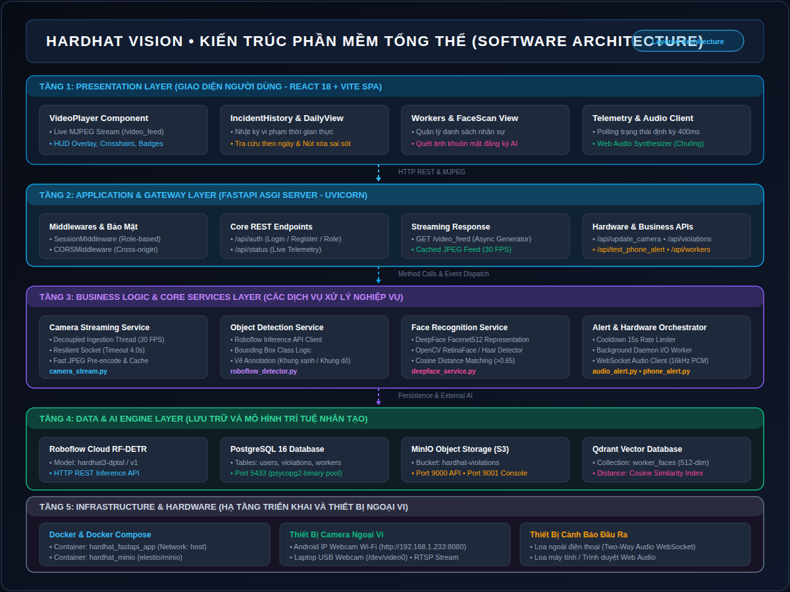
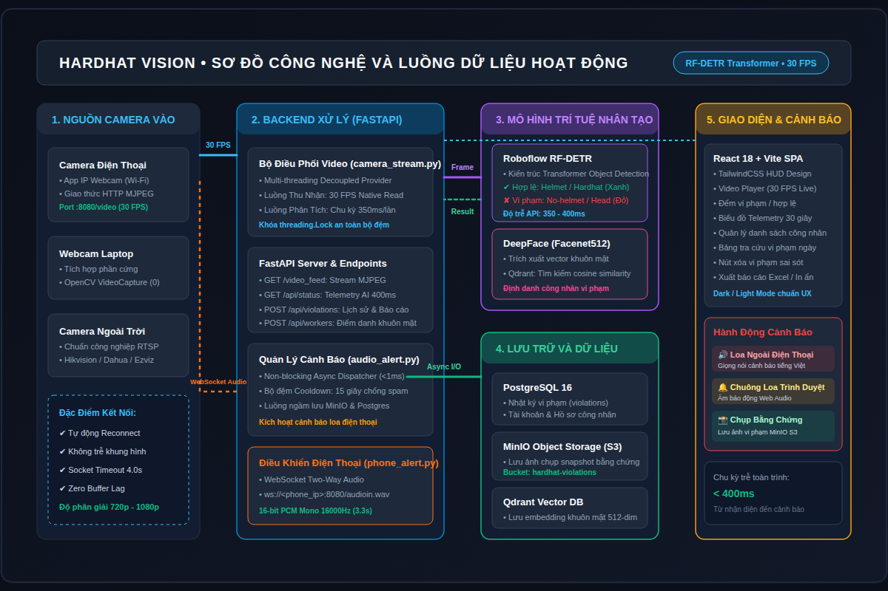
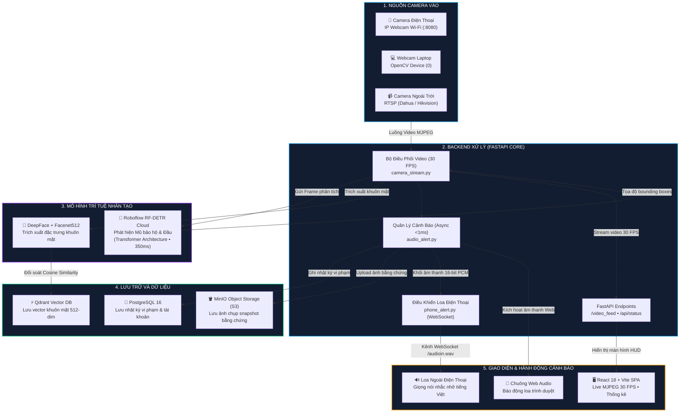

# 🦺 HARDHAT VISION — HỆ THỐNG GIÁM SÁT AN TOÀN MŨ BẢO HỘ THỜI GIAN THỰC

<div align=\"center\">

[](https://fastapi.tiangolo.com/)
[](https://react.dev/)
[](https://roboflow.com/)
[](https://github.com/serengil/deepface)
[](https://www.postgresql.org/)
[](https://min.io/)
[](https://qdrant.tech/)
[](https://www.docker.com/)

**Giải pháp giám sát tuân thủ an toàn lao động tại công trường ứng dụng Thị giác máy tính Transformer (RF-DETR), Nhận diện danh tính khuôn mặt (DeepFace + Qdrant) và Cảnh báo âm thanh loa ngoài điện thoại qua mạng không dây.**

[🎬 Xem Video Demo Sản Phẩm](https://drive.google.com/file/d/1hpTV_4WeVddRU3uG5X9EMlHGdKSoOy5N/view) • [📖 Xem Tài Liệu API Swagger](http://localhost:5000/docs) • [🖥️ Trải Nghiệm Web Dashboard](http://localhost:5000)

</div>

---

## 🎬 Video Trình Chiếu Sản Phẩm Thực Tế (Product Demo)

> 📺 **Bấm vào liên kết dưới đây để xem video vận hành thực tế của hệ thống:**
> 
> 👉 **[XEM VIDEO DEMO TRÊN GOOGLE DRIVE (FULL HD)](https://drive.google.com/file/d/1hpTV_4WeVddRU3uG5X9EMlHGdKSoOy5N/view)**
>
> *(Video minh họa đầy đủ: AI RF-DETR nhận diện người có mũ / không đội mũ, vẽ bounding box trực tiếp trên luồng stream 30 FPS, kích hoạt loa phát âm thanh cảnh báo tiếng Việt to rõ tới điện thoại IP Webcam, lưu trữ ảnh chụp bằng chứng vi phạm vào MinIO S3 và đối soát danh tính công nhân).*

---

## 🌟 Giới Thiệu Dự Án (Overview)

Tại các công trường xây dựng, nhà máy sản xuất và khu chế xuất công nghiệp, việc công nhân quên hoặc cố tình không đội mũ bảo hộ lao động tiềm ẩn nguy cơ tai nạn nghiêm trọng. **HARDHAT VISION** là giải pháp giám sát tự động 24/7 giúp giải quyết triệt để vấn đề này:

* **Không cần đầu tư máy chủ GPU đắt đỏ**: Hệ thống sử dụng mô hình Transformer hiện đại **Roboflow RF-DETR** kết nối điện toán đám mây với độ trễ phản hồi chỉ **~350ms**.
* **Tận dụng camera linh hoạt**: Biến bất kỳ chiếc smartphone nào thành camera giám sát thông minh thông qua mạng Wi-Fi (App IP Webcam), hỗ trợ đồng thời Webcam máy tính và Camera IP công nghiệp (RTSP).
* **Phản xạ cảnh báo tức thời đa kênh**: Khi phát hiện vi phạm, hệ thống tự động phát âm thanh cảnh báo tiếng Việt trực tiếp qua loa ngoài của chiếc điện thoại camera và chuông báo động trên Web Dashboard.
* **Lưu trữ bằng chứng chuẩn đám mây**: Tự động chụp ảnh vi phạm độ nét cao lưu vào **MinIO Object Storage (S3)** và ghi nhận thông số vào **PostgreSQL 16**.

---

## 🚀 Các Tính Năng Nổi Bật (Key Features)

### 1. 🧠 Nhận Diện Mũ Bảo Hộ Bằng Mô Hình RF-DETR (Detection Transformer)
* Ứng dụng kiến trúc **RF-DETR** (Transformer-based Object Detector) với cơ chế tự chú ý (Self-Attention) toàn cục, nhận diện chính xác người đội mũ (**khung xanh**) và không đội mũ (**khung đỏ**) ngay cả khi bị che khuất góc nhìn hoặc công nhân đứng xa.
* Độ trễ suy luận AI siêu tốc đạt **~350 - 400ms**, xử lý luồng hình ảnh đạt **25 - 30 FPS**.

### 2. 👤 Điểm Danh & Nhận Diện Khuôn Mặt Công Nhân (DeepFace + Qdrant)
* Tích hợp mạng nơ-ron **DeepFace (Facenet512)** trích xuất vector đặc trưng khuôn mặt 512 chiều.
* Cơ sở dữ liệu vector **Qdrant** đối soát độ tương đồng (Cosine Similarity) để xác định danh tính công nhân vi phạm, phục vụ công tác kỷ luật và chấm công an toàn.

### 3. 🔊 Cảnh Báo Loa Ngoài Điện Thoại Không Dây (Two-Way Audio WebSocket)
* Tự động stream dữ liệu âm thanh giọng nói tiếng Việt chuẩn 16-bit PCM Mono (`ws://<phone_ip>:8080/audioin.wav`) trực tiếp tới **loa ngoài của điện thoại**.
* Khẩu hiệu cảnh báo: *"Vui lòng đội mũ bảo hộ trước khi vào công trường!"*
* Cơ chế **Decoupled Stream Provider** độc lập giúp video streaming trên Web không bị giật, lag hay đứng hình khi phát âm thanh.

### 4. 🪣 Lưu Trữ Bằng Chứng Chuẩn Doanh Nghiệp (MinIO S3 & PostgreSQL 16)
* Lưu trữ ảnh chụp vi phạm trên cụm lưu trữ đối tượng **MinIO S3 Bucket** (`hardhat-violations`).
* Cơ sở dữ liệu quan hệ **PostgreSQL 16** lưu vết lịch sử vi phạm, thời gian chuẩn giờ Việt Nam (UTC+7), độ tin cậy và nguồn camera.
* Cung cấp nút xóa vi phạm sai sót ngay trên giao diện web để quản trị viên hiệu chỉnh dữ liệu.

### 5. 💻 HUD Web Dashboard Chuẩn Công Nghiệp
* Xây dựng bằng **React 18 + Vite + TailwindCSS**, giao diện kính mờ (Glassmorphism) chuẩn phong cách giám sát an ninh.
* Hỗ trợ đầy đủ chế độ **Dark / Light Mode**, chuyển nguồn camera 1-Click (Webcam laptop, Camera điện thoại Wi-Fi, Camera RTSP ngoài trời), đo FPS thời gian thực và biểu đồ vi phạm theo ngày.

---

## 🏗️ Kiến Trúc Hệ Thống (System & Software Architecture)

### Sơ Đồ Kiến Trúc Phân Tầng (Layered Architecture):



### Sơ Đồ Luồng Hoạt Động Của Hệ Thống (Workflow Diagram):





---

## 🛠️ Ngăn Xếp Công Nghệ (Tech Stack)

| Thành phần | Công nghệ / Thư viện | Vai trò trong hệ thống |
| :--- | :--- | :--- |
| **Backend Engine** | **FastAPI** (Python 3.12), Uvicorn | Xây dựng RESTful API, sinh luồng MJPEG Video Stream hiệu năng cao |
| **Frontend UI** | **React 18**, Vite, Tailwind CSS, Lucide | Giao diện điều khiển thời gian thực phong cách HUD công nghiệp |
| **Object Detection AI** | **Roboflow RF-DETR** | Mô hình Vision Transformer phát hiện người đội mũ / không đội mũ |
| **Biometrics AI** | **DeepFace** (Facenet512), OpenCV | Trích xuất vector đặc trưng khuôn mặt 512 chiều nhận diện công nhân |
| **Vector Database** | **Qdrant** | Tìm kiếm tương đồng vector khuôn mặt (Cosine Distance) |
| **Relational Database**| **PostgreSQL 16**, Psycopg2 | Lưu trữ thông tin tài khoản, phân quyền, lịch sử vi phạm |
| **Object Storage** | **MinIO** (S3-compatible) | Lưu trữ phân tán ảnh snapshot bằng chứng vi phạm |
| **Audio Protocol** | **WebSockets**, Raw 16-bit PCM WAV | Truyền âm thanh hai chiều (Two-Way Audio) tới loa ngoài điện thoại |
| **DevOps & Deploy** | **Docker**, Docker Compose | Đóng gói toàn bộ hệ thống chạy độc lập trên máy chủ hoặc Edge PC |

---

## 📁 Cấu Trúc Thư Mục Dự Án (Project Structure)

```text
hardhat_detection/
├── backend/                       # MÃ NGUỒN BACKEND FASTAPI
│   ├── main.py                    # Khởi tạo FastAPI, định tuyến REST APIs, Generator /video_feed
│   ├── camera_stream.py           # Quản lý luồng video đa luồng, Decoupled Frame Buffer (30 FPS)
│   ├── roboflow_detector.py       # Client kết nối mô hình Roboflow RF-DETR Cloud
│   ├── deepface_service.py        # Dịch vụ trích xuất vector khuôn mặt và tích hợp Qdrant
│   ├── audio_alert.py             # Điều phối cảnh báo âm thanh bất đồng bộ & lưu vết MinIO/DB
│   ├── phone_alert.py             # Điều khiển âm thanh loa ngoài điện thoại qua WebSocket
│   ├── database.py                # Tầng truy xuất dữ liệu PostgreSQL & mã hóa mật khẩu Scrypt
│   ├── minio_storage.py           # Dịch vụ upload và đọc ảnh bằng chứng từ MinIO Object Storage
│   ├── config.py                  # Quản lý cấu hình biến môi trường tập trung (Timezone UTC+7)
│   ├── alert.wav                  # File âm thanh cảnh báo chuẩn 16-bit PCM Mono 16000Hz
│   └── requirements.txt           # Danh mục thư viện Python
│
├── frontend/                      # MÃ NGUỒN FRONTEND REACT SPA
│   ├── src/
│   │   ├── components/
│   │   │   ├── VideoPlayer.jsx    # HUD Video Player, đo FPS và hiển thị Live Stream
│   │   │   ├── IncidentHistory.jsx# Bảng nhật ký vi phạm thời gian thực & nút xóa sai sót
│   │   │   ├── DailyViolationsPage.jsx # Tra cứu lịch sử vi phạm chi tiết theo từng ngày
│   │   │   ├── WorkersPage.jsx    # Quản lý danh sách nhân sự và quét khuôn mặt AI
│   │   │   └── SettingsModal.jsx  # Cửa sổ cấu hình Roboflow API Key và Cooldown
│   │   ├── App.jsx                # Component gốc điều phối trạng thái toàn hệ thống
│   │   └── main.jsx
│   ├── dist/                      # Bản build tối ưu tĩnh phục vụ qua FastAPI
│   └── package.json
│
├── docs/                          # TÀI LIỆU VÀ SƠ ĐỒ THIẾT KẾ
│   ├── software_architecture.png  # Sơ đồ kiến trúc phần mềm 5 tầng
│   ├── system_architecture.png    # Sơ đồ công nghệ và luồng hoạt động
│   └── ...
│
├── static/                        # TÀI NGUYÊN TĨNH
│   ├── audio/alert.mp3            # File âm thanh phát trên loa trình duyệt Web
│   ├── audio/alert.wav            # File âm thanh dự phòng
│   └── workers/                   # Ảnh chân dung khuôn mặt công nhân đăng ký
│
├── Dockerfile                     # Multi-stage production build (Node 20 + Python 3.12)
├── docker-compose.yml             # Cụm dịch vụ Docker (FastAPI App + MinIO Storage)
├── .env                           # File cấu hình biến môi trường (Roboflow, PostgreSQL, MinIO)
└── run_app.sh                     # Script 1-Click khởi động toàn bộ hệ thống
```

---

## ⚡ Hướng Dẫn Cài Đặt & Chạy Ứng Dụng (Quick Start)

### Cách 1: Chạy bằng Docker (Khuyến nghị 1-Click)

Yêu cầu máy tính đã cài đặt **Docker** và **Docker Compose**:

1. **Clone mã nguồn dự án**:
   ```bash
   git clone https://github.com/<your-username>/hardhat_detection.git
   cd hardhat_detection
   ```

2. **Cấu hình file `.env`** (Điền Roboflow API Key của bạn nếu có):
   ```bash
   cp .env.example .env
   # Chỉnh sửa ROBOFLOW_API_KEY trong file .env
   ```

3. **Khởi chạy bằng 1 lệnh duy nhất**:
   ```bash
   docker compose up -d --build
   ```
   *(Hoặc chạy script phím tắt: `./run_app.sh`)*

4. **Truy cập hệ thống**:
   * 🌐 **Giao diện Giám Sát (Web Dashboard)**: [http://localhost:5000](http://localhost:5000)
   * 📚 **Tài liệu API tương tác (Swagger Docs)**: [http://localhost:5000/docs](http://localhost:5000/docs)
   * 🪣 **Bảng điều khiển MinIO S3 Console**: [http://localhost:9001](http://localhost:9001) (`minioadmin` / `minioadmin`)

---

### Cách 2: Chạy trực tiếp trên máy (Manual Development)

1. **Cài đặt thư viện Backend**:
   ```bash
   python3 -m venv venv
   source venv/bin/activate
   pip install -r backend/requirements.txt
   ```

2. **Cài đặt và Build Frontend**:
   ```bash
   cd frontend
   npm install
   npm run build
   cd ..
   ```

3. **Khởi chạy máy chủ FastAPI**:
   ```bash
   uvicorn backend.main:app --host 0.0.0.0 --port 5000 --reload
   ```

---

## 📱 Hướng Dẫn Kết Nối Camera Điện Thoại (IP Webcam)

1. Cài đặt ứng dụng **[IP Webcam](https://play.google.com/store/apps/details?id=com.pas.webcam)** trên điện thoại Android (kết nối cùng mạng Wi-Fi với máy tính).
2. Mở ứng dụng, cuộn xuống dưới cùng và chọn **Start server**.
3. Màn hình điện thoại sẽ hiển thị địa chỉ IP (ví dụ: `http://192.168.1.233:8080`).
4. Trên giao diện Web Dashboard [http://localhost:5000](http://localhost:5000):
   * Nhấn vào thẻ **Camera Điện Thoại (IP Webcam Wi-Fi)** hoặc nhập trực tiếp địa chỉ IP vào ô kết nối nguồn.
   * Nhấn **Kết Nối**: Luồng camera điện thoại sẽ lập tức hiển thị với tốc độ **30 FPS**.
   * Nhấn nút **"Thử Loa ĐT"** trên giao diện: Loa ngoài của chiếc điện thoại sẽ lập tức phát câu cảnh báo tiếng Việt rõ ràng!

---

## 🔐 Tài Khoản Mẫu Trải Nghiệm Hệ Thống

Trên màn hình Đăng Nhập [http://localhost:5000](http://localhost:5000), bạn có thể đăng nhập bằng các tài khoản mẫu:

| Tên Đăng Nhập | Mật Khẩu | Vai Trò (Role) | Quyền hạn |
| :--- | :--- | :--- | :--- |
| **`admin`** | `admin123` | **Quản Trị Viên (Admin)** | Toàn quyền cấu hình AI, chỉnh ngưỡng tin cậy, quản lý công nhân, xóa vi phạm |
| **`guard`** | `guard123` | **Cán Bộ Cổng (Operator)** | Giám sát luồng trực tiếp, kiểm tra danh sách vi phạm ca trực, chụp ảnh bằng chứng |

*(Bạn cũng có thể bấm sang tab **Tạo Tài Khoản** trên màn hình để tự tạo tài khoản mới).*

---

## 📄 Bản Quyền & Tác Giả (License & Authors)

* **Tác giả**: Trần Công Tuấn
* **Đơn vị phát triển**: Dự Án Giám Sát An Toàn Mũ Bảo Hộ Công Trường Thông Minh
* **Giấy phép**: Phát hành theo giấy phép [MIT License](LICENSE).
